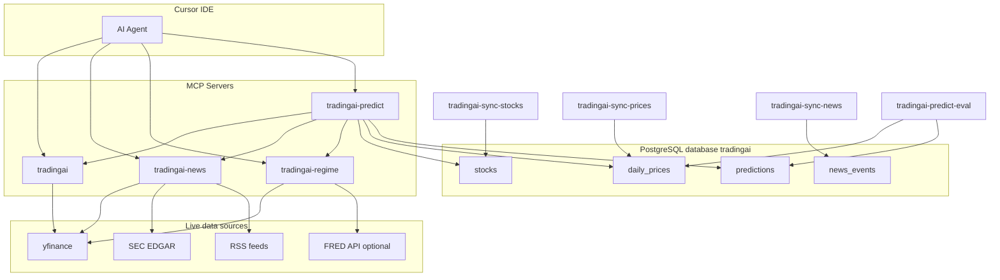

# Trading AI

A Python MCP server suite for Cursor that combines technical analysis, news/sentiment, market-regime detection, and predictive signal fusion into a single research workflow.

---

## User Manual

This section explains how to set up and use the environment end to end: what each step does, why it matters, and where data is stored.

### What this environment does

The project runs **four separate MCP servers** that Cursor can call as tools:

| MCP server | Role |
|------------|------|
| `tradingai` | Technical analysis (indicators, trend bias, multi-ticker comparison) |
| `tradingai-news` | News, filings, analyst actions, and sentiment scoring |
| `tradingai-regime` | Macro market regime (bull/bear/sideways, volatility overlay) |
| `tradingai-predict` | Fuses the three signals above into probabilities and learns from history |

The predict server is the only one that **persists data long-term**. The others fetch live data on demand (with short in-memory caches).

### Architecture overview



---

## Step 1 — Install dependencies

**Purpose:** Install Python packages and console commands (`tradingai-mcp`, `tradingai-sync-prices`, etc.).

**Option A — uv (documented default):**

```bash
uv sync --extra dev
cp .env.example .env
```

**Option B — conda (used in this project's `.cursor/mcp.json`):**

```bash
conda activate stocks
pip install -e ".[dev]"
cp .env.example .env
```

**Where data is stored:** Nothing yet. This step only installs code into your Python environment (`.venv` or conda env).

---

## Step 2 — Configure environment variables

**Purpose:** Tell each MCP server which providers to use and where to find the database.

Edit [`.env`](.env) (copied from [`.env.example`](.env.example)):

| Variable | Purpose |
|----------|---------|
| `TRADINGAI_DATA_PROVIDER` | Market data source for technical analysis (`yfinance`) |
| `TRADINGAI_NEWS_PROVIDERS` | News sources: `yfinance`, `sec_edgar`, `rss` |
| `TRADINGAI_SOCIAL_PROVIDERS` | Social sentiment: `reddit`, optional `x` |
| `SEC_IDENTITY` | Required by SEC for EDGAR API access |
| `TRADINGAI_REGIME_PROVIDERS` | Macro data: `yfinance`, optional `fred` |
| `FRED_API_KEY` | Optional — enriches yield curve, inflation, credit spreads |
| `TRADINGAI_PREDICT_WEIGHTS` | Fusion weights: technical, news, regime (default `0.45,0.35,0.20`) |
| `TRADINGAI_PREDICT_HORIZONS` | Prediction horizons in trading days (default `1,5,20`) |
| `TRADINGAI_DATABASE_URL` | PostgreSQL connection string |
| `TRADINGAI_SYNC_TICKERS` | Watchlist for data sync jobs |

**Where data is stored:** [`.env`](.env) on disk in the project root (local only, not committed to git).

---

## Step 3 — Start PostgreSQL

**Purpose:** Provide persistent storage for stocks, prices, news events, and predictions so the system can learn from history (e.g. "we were right 54% of the time on earnings rallies in semis").

```bash
conda activate stocks
conda install -c conda-forge postgresql psycopg   # first time only
bash scripts/pg-init.sh
```

| Script | Purpose |
|--------|---------|
| `scripts/pg-start.sh` | Starts the Postgres server inside your conda env |
| `scripts/pg-init.sh` | Creates the `tradingai` database and applies the schema |

**Where data is stored:**

| Location | Contents |
|----------|----------|
| PostgreSQL database `tradingai` | All persistent tables (see Step 4) |
| `$CONDA_PREFIX/var/lib/postgresql/data` | Postgres server data files |
| `~/tradingai-pg.log` | Postgres server log |

Connection string (default): `postgresql://localhost:5432/tradingai`

---

## Step 4 — Understand the database tables

**Purpose:** Know what gets saved and where, so you can query history and trust the learning pipeline.

Schema defined in [`src/tradingai/data/schema.sql`](src/tradingai/data/schema.sql):

### `stocks`

Reference data per ticker.

| Column | Example |
|--------|---------|
| `ticker` | `NVDA` |
| `sector` | `Technology` |
| `industry` | `Semiconductors` |
| `market_cap` | `5109662089216` |

**Populated by:** `tradingai-sync-stocks`, or lazily when generating a prediction.

### `daily_prices`

Historical OHLCV bars.

| Column | Example |
|--------|---------|
| `ticker`, `date` | `NVDA`, `2026-07-11` |
| `open`, `high`, `low`, `close`, `volume` | daily bar data |

**Populated by:** `tradingai-sync-prices` (default: ~2 years, then incremental).

**Used by:** `tradingai-predict-eval` to compute actual returns after predictions mature.

### `news_events`

Persisted headlines and catalyst tags.

| Column | Example |
|--------|---------|
| `ticker`, `timestamp`, `headline` | `NVDA`, timestamp, headline text |
| `sentiment` | `0.72` |
| `impact` | `earnings_surprise`, `product_launch`, etc. |

**Populated by:** `tradingai-sync-news`.

### `predictions`

The critical learning table — one row per ticker × timestamp × horizon.

| Column | Purpose |
|--------|---------|
| `probability_up`, `expected_return_pct` | Deterministic forecast (not LLM-generated) |
| `sector`, `regime`, `prediction_type` | Segment labels for track-record queries |
| `catalyst_tags`, `reason_tags` | Normalized tags (e.g. `earnings_surprise`) |
| `actual_return_pct`, `direction_correct` | Filled later by the evaluation job |

**Populated by:** `generate_prediction` MCP tool (via Cursor or CLI).

**Evaluated by:** `tradingai-predict-eval` after horizons (1, 5, 20 days) elapse.

---

## Step 5 — Populate reference data (sync jobs)

**Purpose:** Fill the database with stocks, price history, and news so predictions can be evaluated against real outcomes later.

Run in order:

```bash
# Conda users (replace uv run with direct commands after conda activate stocks):
tradingai-sync-stocks    # or: uv run tradingai-sync-stocks
tradingai-sync-prices
tradingai-sync-news
```

| Command | Purpose | Writes to |
|---------|---------|-----------|
| `tradingai-sync-stocks` | Fetches sector, industry, market cap from yfinance | `stocks` |
| `tradingai-sync-prices` | Downloads ~2 years of OHLCV, then incremental updates | `daily_prices` |
| `tradingai-sync-news` | Fetches headlines and catalyst tags per watchlist ticker | `news_events` |

**Tickers synced:** Defined by `TRADINGAI_SYNC_TICKERS` in `.env` (default: `AAPL,MSFT,NVDA,AMD,INTC,GOOGL,META,TSLA,SPY`).

**Re-run schedule:** Prices daily (before evaluation); stocks weekly; news daily or on demand.

---

## Step 6 — Connect MCP servers to Cursor

**Purpose:** Let the Cursor AI agent call analysis and prediction tools directly from chat.

The project ships [`.cursor/mcp.json`](.cursor/mcp.json) with four server entries. Each points to a console script in your Python environment and loads [`.env`](.env).

1. Open **Cursor → Customize → MCP**
2. Enable `tradingai`, `tradingai-news`, `tradingai-regime`, `tradingai-predict`
3. Restart Cursor if tools do not appear
4. Check **Output → MCP Logs** for startup errors

**Where data is stored:** MCP servers are stateless processes. They read/write Postgres only when predict tools are called. Short-lived caches (15 minutes) exist in memory for yfinance/FRED macro data — not on disk.

---

## Step 7 — Run analysis via Cursor (on-demand)

**Purpose:** Get live insights for a ticker or the overall market. No persistence unless you use the predict server.

### Technical analysis (`tradingai`)

```
Use tradingai to analyze the technical setup for AAPL over 6 months.
Compare technical signals for AAPL, MSFT, and GOOGL.
```

**Data source:** Live yfinance OHLCV. **Storage:** None (transient).

#### Technical ML models (optional)

Train supervised direction models from indicator features on PostgreSQL price history:

```bash
tradingai-sync-prices          # ensure daily_prices is populated (~2y recommended)
tradingai-train-models         # trains baseline, logistic, random_forest, xgboost per horizon
```

Compare models via MCP:

```
Use tradingai to compare_technical_models for horizon 5.
Use tradingai to predict_technical_direction for NVDA with model logistic and horizon 5.
```

To use ML for the technical signal inside fused predictions, set:

```
TRADINGAI_PREDICT_BACKEND=ml
TRADINGAI_ML_MODEL=logistic
TRADINGAI_ML_HORIZON=5
```

Artifacts are saved under `TRADINGAI_ML_MODEL_DIR` (default `./data/models`) with a `manifest.json` metrics summary.

### News and sentiment (`tradingai-news`)

```
Use tradingai-news to analyze sentiment for NVDA and return catalysts and risks.
```

**Data source:** yfinance headlines, SEC EDGAR, RSS. **Storage:** None unless you ran `tradingai-sync-news`.

### Market regime (`tradingai-regime`)

```
Use tradingai-regime to detect the current market regime and recommended strategy.
```

**Data source:** VIX, SPY, optional FRED macro series. **Storage:** None (transient).

---

## Step 8 — Generate and store predictions

**Purpose:** Combine technical, news, and regime signals into deterministic multi-horizon probabilities and save them for later evaluation.

```
Use tradingai-predict to generate a multi-horizon prediction for NVDA.
```

**What happens internally:**

1. Fetches live technical, news, and regime signals
2. Normalizes them to a common score scale
3. Applies weighted fusion + sigmoid (weights from `TRADINGAI_PREDICT_WEIGHTS`)
4. Tags the prediction (e.g. `product_catalyst_rally`, `earnings_driven_rally`)
5. Saves **3 rows** to `predictions` (one per horizon: 1, 5, 20 days)

**Example output:**

| Horizon | Probability up | Expected return |
|---------|---------------|-----------------|
| 1 day | 65% | +0.16% |
| 5 days | 68% | +1.25% |
| 20 days | 64% | +2.54% |

**Where data is stored:** `predictions` table in PostgreSQL.

**Important:** Probabilities are computed by a deterministic function, not invented by the LLM. The LLM should summarize; the numbers come from the fusion engine.

---

## Step 9 — Evaluate predictions (learning loop)

**Purpose:** After 1, 5, and 20 trading days, compare forecasts to actual price moves and compute accuracy metrics. This is how the system "learns" — by querying stored history, not by LLM memory.

```bash
tradingai-predict-eval    # or: uv run tradingai-predict-eval
```

**What this does:**

1. Incrementally syncs latest prices (`tradingai-sync-prices`)
2. For mature predictions, computes `actual_return_pct` from `daily_prices`
3. Sets `direction_correct` (true if return > 0)
4. Prints global and segment-level metrics

**Suggested cron (weekdays after market close):**

```bash
0 18 * * 1-5  tradingai-sync-prices && tradingai-predict-eval
```

**Where data is stored:** Updates `predictions.actual_return_pct`, `direction_correct`, `evaluated_at` in PostgreSQL.

---

## Step 10 — Query track record (how the agent learns)

**Purpose:** Answer questions like "How often were we right on earnings-driven semiconductor rallies over 5 days?" using SQL aggregation, not LLM guesswork.

```
What is our hit rate for earnings-driven rallies in semiconductor stocks over 5 days?
```

The agent should call `get_prediction_track_record` or `get_segment_calibration` from `tradingai-predict`.

**Example response shape:**

```json
{
  "sample_size": 50,
  "hit_rate": 0.54,
  "avg_return_pct": 0.9,
  "avg_predicted_prob": 0.62,
  "overconfidence": 0.08
}
```

**Requirements:** Enough evaluated predictions in the segment. You need Steps 5, 8, and 9 running regularly over several weeks.

---

## Data storage summary

| Data | Stored? | Location | Lifetime |
|------|---------|----------|----------|
| OHLCV used in live MCP calls | No | Fetched from yfinance each request | Transient |
| Macro regime cache | No | In-memory, 15 min TTL | Minutes |
| Stock metadata | Yes | Postgres `stocks` | Persistent |
| Historical prices | Yes | Postgres `daily_prices` | Persistent |
| News headlines / catalysts | Yes | Postgres `news_events` | Persistent |
| Predictions and outcomes | Yes | Postgres `predictions` | Persistent |
| Environment config | Yes | `.env` file (local) | Persistent |
| Postgres server files | Yes | `$CONDA_PREFIX/var/lib/postgresql/data` | Persistent |

---

## Daily workflow (recommended)

| When | Action | Purpose |
|------|--------|---------|
| Once (setup) | `pg-init.sh`, configure `.env`, enable MCP servers | Bootstrap |
| Daily (before analysis) | `tradingai-sync-prices` | Fresh price data for evaluation |
| On demand | Ask Cursor to analyze tickers or generate predictions | Research |
| Daily (after close) | `tradingai-predict-eval` | Backfill outcomes, update metrics |
| Weekly | `tradingai-sync-stocks`, `tradingai-sync-news` | Refresh metadata and news |

---

## MCP tool reference

### `tradingai` — Technical Analysis

| Tool | Description |
|------|-------------|
| `get_ohlcv` | Fetch normalized OHLCV history |
| `calculate_indicators` | Compute RSI, MACD, SMA/EMA, Bollinger Bands, ATR, momentum, volatility, volume anomalies, relative strength |
| `analyze_technical_setup` | Return trend/momentum/volatility signals plus a summary |
| `compare_technical_signals` | Compare technical bias across multiple tickers |
| `compare_technical_models` | Compare trained ML models (accuracy, Brier, precision, recall) from the latest manifest |
| `predict_technical_direction` | Predict up/down probability using a trained ML model (baseline, logistic, random_forest, xgboost) |

### `tradingai-news` — News / Sentiment

| Tool | Description |
|------|-------------|
| `fetch_company_news` | Recent headlines from enabled providers |
| `fetch_press_releases` | Press releases and IR announcements |
| `fetch_sec_filings` | Recent SEC 8-K, 10-Q, and 10-K filings |
| `fetch_earnings_materials` | Latest earnings press release and transcript when available |
| `fetch_analyst_actions` | Analyst upgrades, downgrades, and recommendation changes |
| `fetch_social_sentiment` | Filtered Reddit/X posts with social-only sentiment score |
| `analyze_news_sentiment` | Structured sentiment report with catalysts and risk factors |

### `tradingai-regime` — Market Regime

| Tool | Description |
|------|-------------|
| `fetch_macro_features` | Raw and derived macro feature values (VIX, SPY trend, yields, inflation, credit) |
| `detect_market_regime` | Primary tool — regime label, recommended strategy, confidence, and signal breakdown |
| `explain_regime` | Human-readable explanation of the current regime |

### `tradingai-predict` — Predictive Signal Fusion

| Tool | Description |
|------|-------------|
| `get_agent_signals` | Normalized technical, news, and regime signals for a ticker |
| `generate_prediction` | Primary tool — fuse signals, compute 1/5/20-day probabilities, auto-save to PostgreSQL |
| `explain_prediction` | Human-readable evidence summary with deterministic probability numbers |
| `evaluate_predictions` | Backfill actual returns for mature predictions |
| `get_evaluation_metrics` | Accuracy, precision/recall, MAE, Brier score, top-10 ranked return |
| `get_prediction_history` | Query stored predictions for a ticker or date range |
| `get_prediction_track_record` | Segment hit rate, average return, and overconfidence |
| `get_segment_calibration` | Accuracy and Brier score by sector and prediction type |

---

## Configuration reference

### Optional providers

- `newsapi` — requires `NEWS_API_KEY`
- `finnhub` — requires `FINNHUB_API_KEY`
- `x` — requires `X_BEARER_TOKEN` (X API v2 bearer token)
- `reddit` — uses public JSON API; if blocked, set `REDDIT_CLIENT_ID` and `REDDIT_CLIENT_SECRET`
- `fred` — requires `FRED_API_KEY` (free at [fred.stlouisfed.org](https://fred.stlouisfed.org/docs/api/api_key.html))

### Social sentiment notes

- Reddit is enabled by default; uses public API first, then PRAW credentials if configured
- X is optional and only activates when `x` is listed in `TRADINGAI_SOCIAL_PROVIDERS` and `X_BEARER_TOKEN` is set
- Social posts are noise-filtered (spam, memes, low engagement, missing ticker mentions)
- Social sentiment is weighted lower than news/filings via `TRADINGAI_SOCIAL_WEIGHT` (default `0.45`)

---

## Development

### Run MCP servers directly (for debugging)

```bash
tradingai-mcp
tradingai-news-mcp
tradingai-regime-mcp
tradingai-predict-mcp
```

### Run tests

```bash
pytest
pytest -m integration    # live network tests
```

### Optional: migrate legacy SQLite predictions

If you have an old `./data/predictions.sqlite3` from before the Postgres migration:

```bash
python scripts/migrate_sqlite_to_postgres.py
```

---

## Prerequisites

- Python 3.12+
- [uv](https://docs.astral.sh/uv/) or conda
- PostgreSQL (via conda-forge, for the learning pipeline)

---

## Roadmap

- Alpaca provider for paper/live market data
- Portfolio and order tools
- Supervised weight learning from prediction history (partially addressed by technical ML models)

---

## Disclaimer

This project provides analysis for informational purposes only. It is not financial advice. Probabilities are produced by a rule-based fusion model and are not guaranteed to be calibrated until sufficient prediction history has been evaluated.
