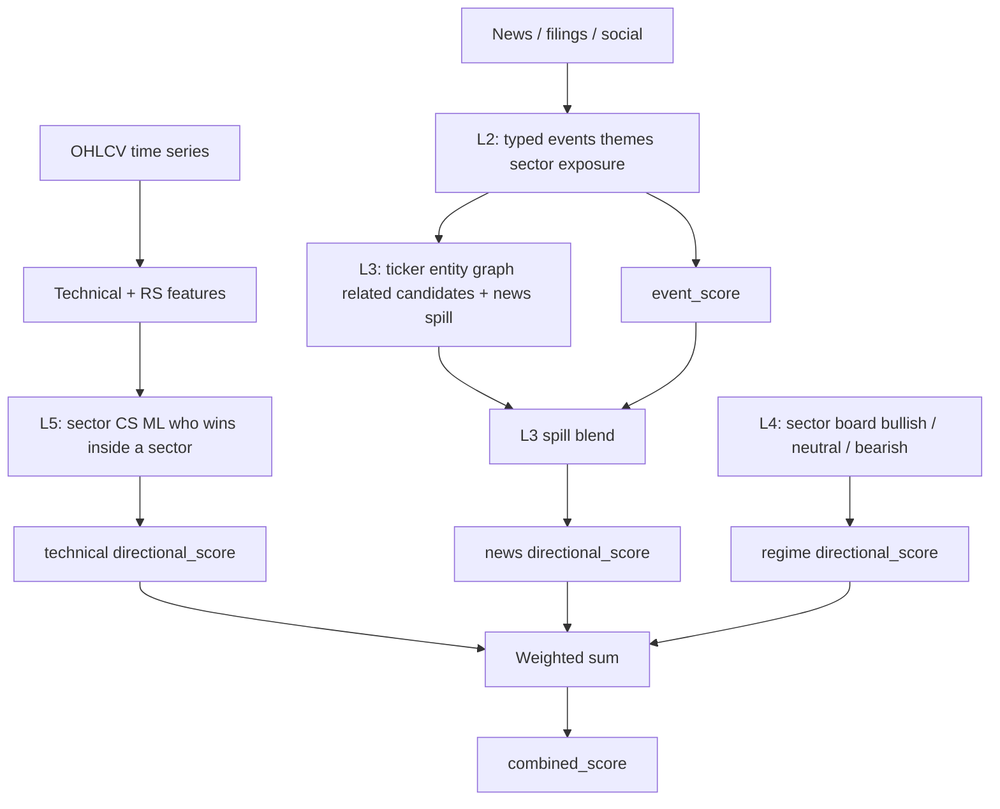

# How `combined_score` is built

End-to-end path from prices and news to the fused score used by predictions and (by default) the paper portfolio.



| Layer | Meaning in this graph |
|-------|------------------------|
| **L2** | News as typed events → themes → sector exposure → `event_score` |
| **L3** | Ticker entity graph: related names; inbound spill into news score |
| **L4** | Sector board stance that feeds the regime agent |
| **L5** | Cross-sectional ML on prices: peer-beat prob → technical score |

*(L1 is market-level factors behind the regime board; it isn’t a separate node in this fusion path.)*

## Fusion formula

```text
combined_score =
    w_tech   * technical_score
  + w_news   * news_score
  + w_regime * regime_score
```

Weights come from tuned `data/fusion_weights.json` or `TRADINGAI_PREDICT_WEIGHTS` (default ~0.45 / 0.35 / 0.20).

L3 spill blend weight α comes from tuned `l3_news_spill_alpha` in `data/news_scoring.json` (via `tradingai-tune-fusion`) when news scoring load is enabled; otherwise `TRADINGAI_L3_NEWS_SPILL_ALPHA` (default `0.25`).

Assumes `TRADINGAI_PREDICT_BACKEND=ml` for the technical leg (L5). With `fusion`, technical is rule-based indicators instead of the CS model.
