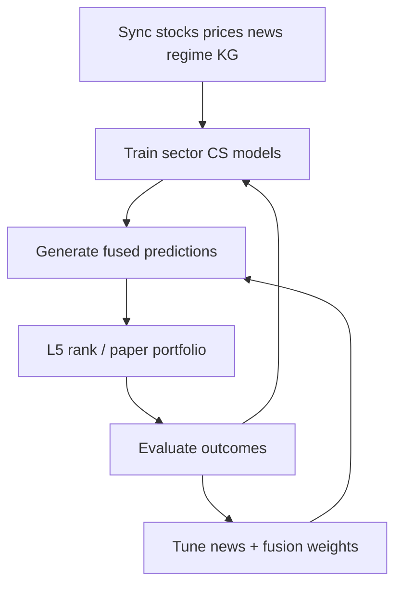
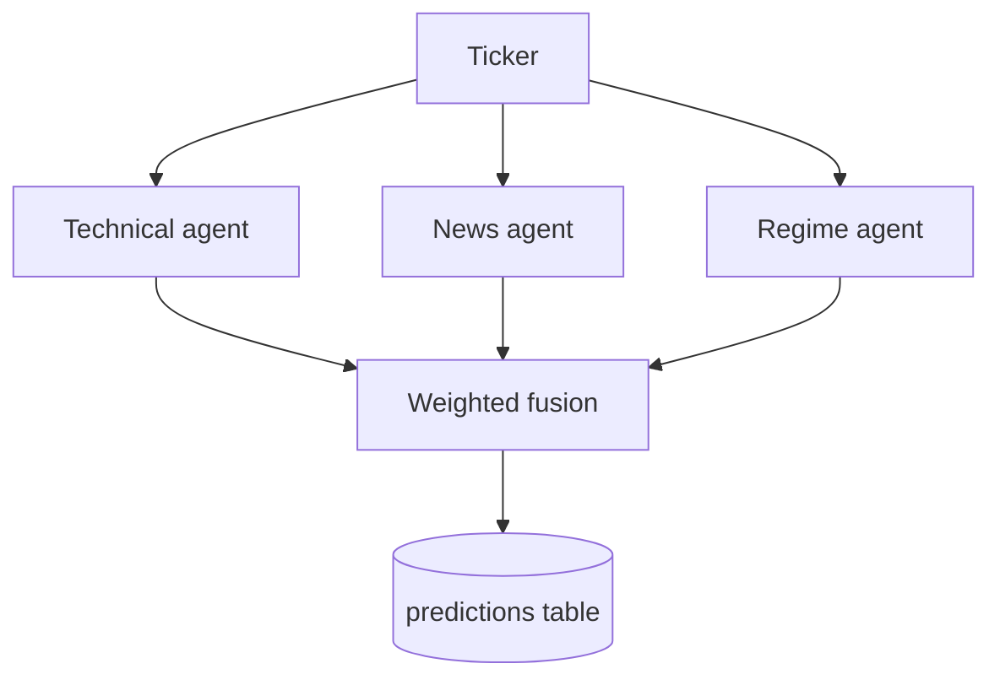

# TradingAI workflow: data → predictions → portfolio

End-to-end manual for the current stack: sync jobs, L1–L5 layers, fusion predictions, and paper portfolios.

## Overview



**Mental model**

| Layer | Role |
|-------|------|
| **L1 / L4** | Market factors + sector board: which sectors are tradable (`bullish` / `neutral` / `bearish`) |
| **L2** | News as typed events → ontology → sector exposure (news agent score) |
| **L3** | Static ticker graph → related candidates; inbound spill blends cached neighbor news into the news agent score |
| **L5** | Cross-sectional ML: who wins *inside* a bullish sector |
| **Fusion** | Weighted technical + news + regime → stored multi-horizon probabilities |

L4 chooses the playground; L5 ranks names inside it; fusion still blends tech/news/regime into stored scores.

---

## 1. Collect and store data

Watchlist comes from `TRADINGAI_SYNC_TICKERS` in `.env`.

| Step | Command | Writes |
|------|---------|--------|
| Universe metadata | `tradingai-sync-stocks` | `stocks` (sector, industry, market cap) |
| Prices | `tradingai-sync-prices` | `daily_prices` (equities + macros SPY/VIX/HYG/LQD, sector ETFs) |
| Regime board | `tradingai-sync-regime` | `regime_snapshots` (L1 factors + L4 sector stances) |
| News | `tradingai-sync-news` | `news_events` + L2 `news_graph_events` |
| Entity graph | `tradingai-sync-ticker-kg` | `ticker_kg_nodes` (static L3 DB mirror; `--preserve-overlays` default) |

Optional L3 LLM curator (human-approved; spill uses applied overlays + seed at runtime):

```bash
tradingai-propose-ticker-kg MSFT              # OPENAI_API_KEY by default
tradingai-propose-ticker-kg MSFT --provider groq   # GROQ_API_KEY + Groq OpenAI-compatible API
tradingai-apply-ticker-kg <path>              # writes DB overlay used by related_candidates
```

L3 news spill (`TRADINGAI_L3_NEWS_SPILL=1`, default): when adapting the news agent, blend ticker T’s own L2 `event_score` with cached neighbor sentiment snapshots (α via `TRADINGAI_L3_NEWS_SPILL_ALPHA`, default `0.25`). Snapshots keep the unspilled own score so neighbor lookups do not recurse. Portfolio still ranks via fusion `combined_score` (or `TRADINGAI_PORTFOLIO_RANK_KEY`).

**Suggested cadence:** prices daily; stocks/news weekly; regime when you want a fresh board.

```bash
tradingai-sync-stocks
tradingai-sync-prices
tradingai-sync-regime
tradingai-sync-news
tradingai-sync-ticker-kg
```

---

## 2. Train the ML job (L5)

Primary training path is **per-sector cross-sectional** models (not global absolute direction):

```bash
tradingai-train-models --by-sector --cross-section --horizon 5
```

What this does:

- Features from prices: technical indicators, SPY relative strength, **sector ETF relative strength**, optional regime features.
- Labels = **above same-date sector peer median** (`cs_label`), not absolute up/down.
- Artifacts under `data/models/sectors/<slug>/horizon_N/` (see `TRADINGAI_ML_MODEL_DIR`).

Relevant env (see `.env.example`):

```text
TRADINGAI_ML_LABEL_MODE=cross_section
TRADINGAI_ML_ALLOW_GLOBAL_FALLBACK=false
TRADINGAI_L5_RANKING=true
TRADINGAI_PREDICT_BACKEND=ml    # optional: fusion technical agent uses CS models
```

After changing feature schema (regime columns, sector RS, etc.), retrain — old artifacts will not match.

---

## 3. Generate predictions (per ticker)

Via MCP `generate_prediction` or batch:

```bash
tradingai-predict-batch
tradingai-predict-batch --bullish-sectors-only   # L5 universe only
```



### Technical agent

- Rule-based indicators, **or**
- ML (`TRADINGAI_PREDICT_BACKEND=ml`): load sector CS artifact → `cs_prob` → directional score; persisted as `ml_rank_score` when present.

### News agent (L2 + L3)

- Headlines/filings → typed events → theme ontology → sector exposure → news `directional_score`.
- Scalar sentiment stays in `raw` (fallback if no events match).
- L3 attaches `related_candidates` and, when `TRADINGAI_L3_NEWS_SPILL=1`, blends cached neighbor news scores into the news agent directional score (own `event_score` in raw stays L2-only).
- Edges come from the static seed and/or **LLM curator overlays** in `ticker_kg_nodes` (propose → review → apply).

MCP helpers: `analyze_news_sentiment`, `get_news_events`, `get_ticker_graph`, `get_related_tickers`, `propose_ticker_graph_edges`, `apply_ticker_graph_edges`.

### Regime agent (L1 / L4)

- Live (or synced) board: ticker’s sector stance → soft regime score in fusion (`bullish` / `neutral` / `bearish`).

MCP: `get_regime_state`.

### Fusion

- Weighted sum (tuned file `data/fusion_weights.json` or `TRADINGAI_PREDICT_WEIGHTS`).
- Multi-horizon outputs (`TRADINGAI_PREDICT_HORIZONS`, default 3 / 5 / 8).
- Rows written to `predictions` (scores, sector, regime, optional `ml_rank_score` / `sector_rank`).
- Retune offline after eval — see [§6](#6-tune-the-fusion-model-offline).

---

## 4. Rank and build portfolio (L5 surface)

### Live ranking

MCP `rank_sector_candidates`:

- Eligible sectors = L4 `stance == bullish` (or pass one `sector`).
- Score peers with CS models → ranked candidates by `ml_score`.

```
Use tradingai-predict to rank_sector_candidates.
Use tradingai-predict to rank_sector_candidates for Technology.
```

### Paper portfolio

```bash
tradingai-paper-portfolio
# or MCP get_paper_portfolio
```

Flow:

1. Load latest prediction per ticker for the horizon (`TRADINGAI_ML_HORIZON`).
2. If `TRADINGAI_L5_RANKING=true`, keep **bullish-sector** rows only (gate unchanged by rank key).
3. Sort/weight by `TRADINGAI_PORTFOLIO_RANK_KEY` (`combined_score` default, or `ml_rank_score`); falls back to the other field when missing.
4. Apply filters (`min_probability_up`, `max_per_sector`, broad-ETF caps).
5. Assign weights + cash buffer → `data/paper_portfolio.json` (and CSV).

---

## 5. Learn from outcomes

```bash
tradingai-sync-prices && tradingai-predict-eval
```

After horizons mature (3 / 5 / 8 trading days):

- Backfills `actual_return_pct` / `direction_correct` on `predictions`.
- Enables track record, segment calibration, and offline tuning below.

---

## 6. Tune the fusion model (offline)

Nested optimizer: **news scoring** → **L2 event graph** → **fusion agent weights / horizon scales**. Each phase writes JSON that prediction time auto-loads (when enabled).

```bash
tradingai-sync-prices && tradingai-predict-eval   # need evaluated rows first
tradingai-tune-fusion                             # news → event-graph → fusion
tradingai-tune-fusion --dry-run                   # preview metrics, no write
tradingai-tune-fusion --skip-news                 # skip news phase
tradingai-tune-fusion --skip-events               # skip L2 event-graph phase
tradingai-tune-fusion --news-only                 # news scoring only
tradingai-tune-fusion --events-only               # news (unless --skip-news) + event-graph; skip fusion
```

### What it searches

| Phase | Inputs | Objective | Writes |
|-------|--------|-----------|--------|
| **News** | Evaluated rows with `scoring_snapshot` in `agent_payload.news` | Grid source blend + recency half-life; minimize validation Brier (fusion weights held fixed) | `data/news_scoring.json` |
| **L2 events** | Rows with stored `events` and/or `event_text_corpus` | Greedy knobs + THEME_EDGES weights + EVENT_SPECS enable/theme remap/pattern ablation | `data/event_graph.json` |
| **Fusion** | Re-simulated `news_score` (events preferred, else sentiment) + stored tech/regime scores | Grid technical/news/regime weights + per-horizon sigmoid scales | `data/fusion_weights.json` |

Useful flags: `--min-samples` (default 30), `--horizon N`, `--weight-step 0.05`, `--train-fraction 0.7`, `--output` / `--news-output` / `--events-output`.

### Requirements

- **Fusion phase:** ≥ `--min-samples` evaluated rows **per horizon**.
- **News phase:** ≥ `--min-samples` evaluated rows **with** `scoring_snapshot`.
- **Event-graph phase:** ≥ `--min-samples` rows with `events` and/or `event_text_corpus`. Pattern ablation only runs on rows that include `event_text_corpus` (new predictions after corpus support).

### How inference picks up the result

| Env | Role |
|-----|------|
| `TRADINGAI_FUSION_TUNING_ENABLED=1` (default) | Load `TRADINGAI_FUSION_TUNING_PATH` (default `./data/fusion_weights.json`) |
| `TRADINGAI_NEWS_SCORING_ENABLED=1` (default) | Load `TRADINGAI_NEWS_SCORING_PATH` (default `./data/news_scoring.json`) |
| `TRADINGAI_EVENT_GRAPH_ENABLED=1` (default) | Load `TRADINGAI_EVENT_GRAPH_PATH` (default `./data/event_graph.json`) |
| Set any to `0` | Fall back to env/code defaults for that layer |

Restart MCP servers / workers after tuning so config caches reload. New `tradingai-predict-batch` runs then use the tuned weights; L5 ranking and paper portfolio still sit on top of those fused scores.

Suggested cadence: retune weekly once eval history is large enough (see README Step 9b for full detail).

---

## One-line ops loop

Sync stocks / prices / news / regime / ticker-kg → train sector CS models → batch predict (bullish-only optional) → paper portfolio from ranked bullish names → evaluate after horizons mature → `tradingai-tune-fusion` → retrain / re-predict as needed.

---

## Quick command cheat sheet

```bash
# Data
tradingai-sync-stocks
tradingai-sync-prices
tradingai-sync-regime
tradingai-sync-news
tradingai-sync-ticker-kg
# optional: tradingai-propose-ticker-kg MSFT && tradingai-apply-ticker-kg <proposal.json>

# Models
tradingai-train-models --by-sector --cross-section --horizon 5

# Predict + portfolio
tradingai-predict-batch --bullish-sectors-only
tradingai-paper-portfolio

# Evaluate + tune fusion
tradingai-sync-prices && tradingai-predict-eval
tradingai-tune-fusion
# tradingai-tune-fusion --dry-run
# tradingai-tune-fusion --skip-news
# tradingai-tune-fusion --skip-events
# tradingai-tune-fusion --events-only
```

For MCP tool lists and setup, see [README.md](README.md).
